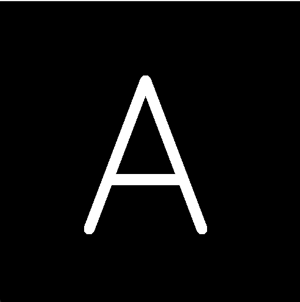
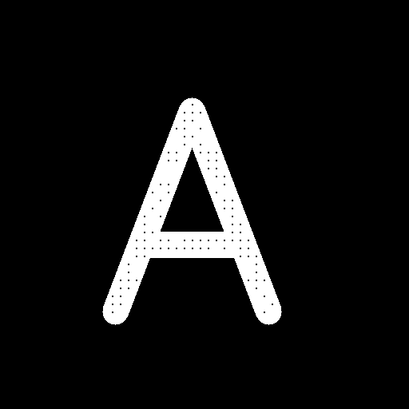
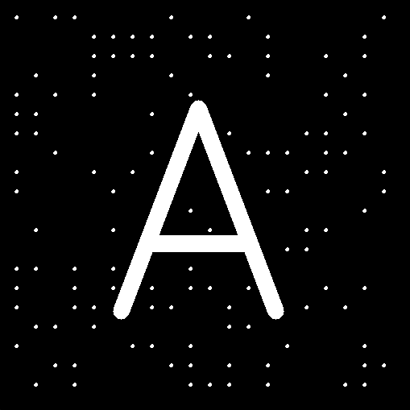

# 영상처리 과제 (11/06)

## 1. Morphology — `morphology_1106.py`

OpenCV 내장 함수(`cv.erode`, `cv.dilate`) 없이 반복문으로 직접 구현한 형태학 연산입니다.

| 연산 | 입력 영상 | 커널 |
|---|---|---|
| Opening (침식 → 팽창) | `12345.png` (A + 점 노이즈) | 3×3 사각형 |
| Closing (팽창 → 침식) | `closer.png` (A 안쪽 구멍) | 3×3 사각형 |
| Dilation | `12345.png` | 3×3 십자형 |
| Erosion | `12345.png` | 3×3 십자형 |

- 영상 바깥은 0으로 패딩
- 실행하면 입력/결과 영상이 창으로 표시되고, 아무 키나 누르면 종료

### 실행 결과

<!-- results 폴더에 캡처 이미지를 넣고 아래 경로를 맞춰주세요 -->
| 입력 | Opening |
|---|---|
|  |  |

| 입력 | Closing |
|---|---|
|  |  |

| Dilation | Erosion |
|---|---|
|  |  |

## 2. KNN 분류 — `KNN1106.py`

CIFAR-10 이미지를 픽셀 벡터(3072차원)로 펼쳐서 직접 구현한 KNN으로 분류합니다.

- 데이터: 학습 5,000장 / 테스트 1,000장 (클래스 비율 유지 샘플링, `random_state=42`)
- 거리: 유클리드(L2), 맨해튼(L1)
- k: 1, 3, 5
- 5-fold 교차검증으로 평균 정확도가 가장 높은 (거리, k) 조합을 고른 뒤 테스트셋으로 최종 평가
- 지표: Accuracy, Precision / Recall / F1 (macro 평균)

CIFAR-10 데이터는 처음 실행할 때 `data/` 폴더에 자동으로 다운로드됩니다.
순수 Python 반복문으로 거리를 계산해서 실행에 시간이 꽤 걸립니다.

### 실행 결과

<!-- 콘솔 출력 캡처를 results 폴더에 넣어주세요 -->


## 실행 방법

```bash
pip install -r requirements.txt
python morphology_1106.py
python KNN1106.py
```
