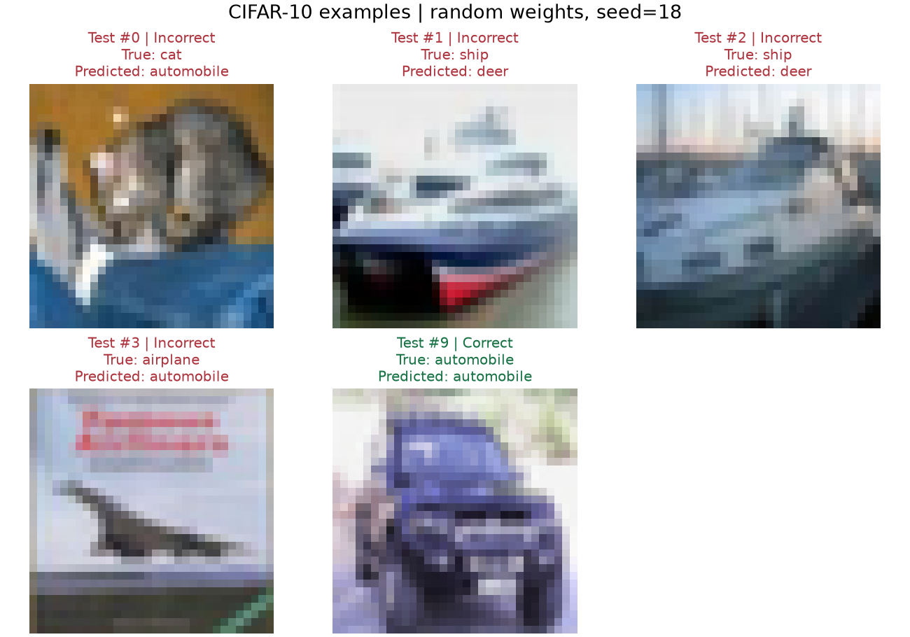
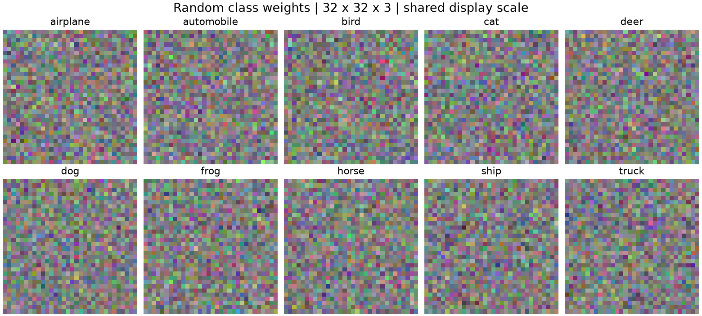

# 선형 분류 과제 · 11월 18일

CIFAR-10 이미지에서 무작위로 초기화한 선형 분류기의 클래스 점수, 다중 클래스 SVM hinge loss, Softmax 확률을 확인한다.

## 입력과 가중치 초기화

공식 테스트 세트의 RGB 이미지를 사용했다. 이미지 한 장의 크기는 32×32×3이다. `torchvision`이 반환한 `(높이, 너비, RGB)` 순서의 배열을 길이 3,072로 펼치고 픽셀값을 255로 나누어 0~1 범위로 바꿨다.

`np.random.default_rng(18)`로 난수를 고정했다. 가중치 `W`는 평균 0, 표준편차 0.01의 정규분포에서 뽑았고, 편향 `b`는 0으로 설정했다. `W.shape=(10, 3072)`, `b.shape=(10,)`이며 행 번호가 클래스 번호에 해당한다. 초기화한 가중치와 편향을 사용해 계산했다.

선형 분류기는 `f(x)=Wx+b`로 각 클래스의 점수를 계산하고 `argmax`로 예측한다. 이 구현은 무작위 초기 가중치를 사용하는 선형 분류기의 순전파 과정이다.

## 클래스 점수와 예측

```python
scores = W @ x + b
prediction = np.argmax(scores)
```

먼저 테스트 인덱스 0~3을 선택했다. 같은 가중치로 테스트 이미지를 앞에서부터 확인해 처음 만난 정답 사례와 오답 사례가 목록에 없으면 추가했다. 아래 평균 손실은 이 선택 목록의 이미지들을 각각 한 번씩 사용해 계산했다.



| 테스트 인덱스 | 실제 클래스 | 최고 점수 클래스 | 분류 결과 | SVM hinge loss | Softmax 확률 합 |
| --- | --- | --- | --- | --- | --- |
| 0 | cat | automobile | 오답 | 9.35260639 | 1.000000000000 |
| 1 | ship | deer | 오답 | 10.27889438 | 1.000000000000 |
| 2 | ship | deer | 오답 | 10.23276343 | 1.000000000000 |
| 3 | airplane | automobile | 오답 | 10.21004937 | 1.000000000000 |
| 9 | automobile | automobile | 정답 | 6.57219608 | 1.000000000000 |

## 클래스별 점수 비교

행은 클래스, 열은 선택한 테스트 이미지다. 각 열에서 가장 높은 점수의 클래스가 예측 결과다.

| 클래스 번호 | 클래스 | 테스트 #0 | 테스트 #1 | 테스트 #2 | 테스트 #3 | 테스트 #9 |
| --- | --- | --- | --- | --- | --- | --- |
| 0 | airplane | -0.29339099 | -0.07274030 | -0.29125977 | -0.38833651 | -0.20857788 |
| 1 | automobile | 0.12738826 | -0.33787202 | -0.13451112 | -0.03849139 | 0.06737830 |
| 2 | bird | -0.37819061 | -0.56643791 | -0.40689961 | -0.47423731 | -0.29364194 |
| 3 | cat | -0.25033519 | -0.09943950 | -0.24865037 | -0.30481048 | -0.12574296 |
| 4 | deer | -0.02276660 | 0.18276845 | 0.08394880 | -0.04393880 | 0.03691108 |
| 5 | dog | -0.28377761 | -0.16945980 | -0.28853478 | -0.30318810 | -0.21357563 |
| 6 | frog | -0.09904681 | -0.34451994 | -0.27856372 | -0.20662854 | -0.15885949 |
| 7 | horse | -0.21655752 | 0.17022034 | -0.00218483 | -0.18225189 | -0.08690064 |
| 8 | ship | -0.47321093 | -0.34732254 | -0.35148228 | -0.32165993 | -0.38633752 |
| 9 | truck | -0.26085750 | -0.60952781 | -0.36392172 | -0.40977277 | -0.38467422 |

## 클래스별 Softmax 확률 비교

각 열의 10개 확률을 더하면 1이다. 아래 수치는 반올림해 표시했다.

| 클래스 번호 | 클래스 | 테스트 #0 | 테스트 #1 | 테스트 #2 | 테스트 #3 | 테스트 #9 |
| --- | --- | --- | --- | --- | --- | --- |
| 0 | airplane | 0.09116478 | 0.11196194 | 0.09275156 | 0.08772293 | 0.09567627 |
| 1 | automobile | 0.13885745 | 0.08588655 | 0.10849164 | 0.12446549 | 0.12608125 |
| 2 | bird | 0.08375275 | 0.06833769 | 0.08262271 | 0.08050204 | 0.08787420 |
| 3 | cat | 0.09517568 | 0.10901220 | 0.09678905 | 0.09536479 | 0.10393911 |
| 4 | deer | 0.11949721 | 0.14455611 | 0.13498087 | 0.12378932 | 0.12229783 |
| 5 | dog | 0.09204541 | 0.10164024 | 0.09300465 | 0.09551963 | 0.09519930 |
| 6 | frog | 0.11072092 | 0.08531748 | 0.09393664 | 0.10520295 | 0.10055338 |
| 7 | horse | 0.09844540 | 0.14275354 | 0.12384112 | 0.10779896 | 0.10805578 |
| 8 | ship | 0.07616094 | 0.08507870 | 0.08733069 | 0.09377140 | 0.08009478 |
| 9 | truck | 0.09417946 | 0.06545556 | 0.08625108 | 0.08586249 | 0.08022811 |

## SVM hinge loss와 Softmax 계산

정답 클래스가 `y`, 클래스 점수가 `s`, 마진이 `delta=1`일 때 이미지별 손실은 다음과 같다.

$$L_i=\sum_{j\ne y_i}\max(0,\ s_j-s_{y_i}+1)$$

정답 클래스 자신은 합에서 제외했다. 이 과제에서는 클래스별 마진의 합을 사용했다. 모든 이미지의 평균은 이미지별 손실 합을 선택 이미지 수로 나눠 구했다.

**선택한 5개 이미지의 평균 SVM hinge loss = 9.32930193**

Softmax는 각 클래스 점수의 지수값을 전체 클래스 지수값의 합으로 나눈다. 수치 안정성을 위해 모든 점수에서 최고 점수를 뺀 뒤 계산했다.

$$p_j=\frac{\exp(s_j-\max_k s_k)}{\sum_k\exp(s_k-\max_l s_l)}$$

각 이미지의 확률 합을 `np.isclose(sum, 1.0)`으로 확인했다. Softmax는 점수의 순서를 유지하므로 최고 점수 클래스와 최고 확률 클래스가 같다. 확률 합이 1인 것은 정규화 결과이며, 예측이 정답인지와는 별개다.

## 예시별 10개 클래스의 점수와 확률

### 테스트 #0 · 실제 cat → 예측 automobile

| 클래스 | 원래 점수 | Softmax 확률 | hinge 마진 기여 |
| --- | --- | --- | --- |
| airplane | -0.29339099 | 0.09116478 | 0.95694420 |
| automobile | 0.12738826 | 0.13885745 | 1.37772345 |
| bird | -0.37819061 | 0.08375275 | 0.87214458 |
| cat | -0.25033519 | 0.09517568 | 0.00000000 |
| deer | -0.02276660 | 0.11949721 | 1.22756859 |
| dog | -0.28377761 | 0.09204541 | 0.96655758 |
| frog | -0.09904681 | 0.11072092 | 1.15128838 |
| horse | -0.21655752 | 0.09844540 | 1.03377767 |
| ship | -0.47321093 | 0.07616094 | 0.77712426 |
| truck | -0.26085750 | 0.09417946 | 0.98947769 |

손실 `9.35260639`, 확률 합 `1.000000000000`, 합이 1인지 확인 `True`.

### 테스트 #1 · 실제 ship → 예측 deer

| 클래스 | 원래 점수 | Softmax 확률 | hinge 마진 기여 |
| --- | --- | --- | --- |
| airplane | -0.07274030 | 0.11196194 | 1.27458224 |
| automobile | -0.33787202 | 0.08588655 | 1.00945052 |
| bird | -0.56643791 | 0.06833769 | 0.78088463 |
| cat | -0.09943950 | 0.10901220 | 1.24788304 |
| deer | 0.18276845 | 0.14455611 | 1.53009099 |
| dog | -0.16945980 | 0.10164024 | 1.17786274 |
| frog | -0.34451994 | 0.08531748 | 1.00280260 |
| horse | 0.17022034 | 0.14275354 | 1.51754288 |
| ship | -0.34732254 | 0.08507870 | 0.00000000 |
| truck | -0.60952781 | 0.06545556 | 0.73779473 |

손실 `10.27889438`, 확률 합 `1.000000000000`, 합이 1인지 확인 `True`.

### 테스트 #2 · 실제 ship → 예측 deer

| 클래스 | 원래 점수 | Softmax 확률 | hinge 마진 기여 |
| --- | --- | --- | --- |
| airplane | -0.29125977 | 0.09275156 | 1.06022251 |
| automobile | -0.13451112 | 0.10849164 | 1.21697116 |
| bird | -0.40689961 | 0.08262271 | 0.94458267 |
| cat | -0.24865037 | 0.09678905 | 1.10283191 |
| deer | 0.08394880 | 0.13498087 | 1.43543108 |
| dog | -0.28853478 | 0.09300465 | 1.06294750 |
| frog | -0.27856372 | 0.09393664 | 1.07291857 |
| horse | -0.00218483 | 0.12384112 | 1.34929745 |
| ship | -0.35148228 | 0.08733069 | 0.00000000 |
| truck | -0.36392172 | 0.08625108 | 0.98756056 |

손실 `10.23276343`, 확률 합 `1.000000000000`, 합이 1인지 확인 `True`.

### 테스트 #3 · 실제 airplane → 예측 automobile

| 클래스 | 원래 점수 | Softmax 확률 | hinge 마진 기여 |
| --- | --- | --- | --- |
| airplane | -0.38833651 | 0.08772293 | 0.00000000 |
| automobile | -0.03849139 | 0.12446549 | 1.34984512 |
| bird | -0.47423731 | 0.08050204 | 0.91409919 |
| cat | -0.30481048 | 0.09536479 | 1.08352602 |
| deer | -0.04393880 | 0.12378932 | 1.34439771 |
| dog | -0.30318810 | 0.09551963 | 1.08514841 |
| frog | -0.20662854 | 0.10520295 | 1.18170797 |
| horse | -0.18225189 | 0.10779896 | 1.20608462 |
| ship | -0.32165993 | 0.09377140 | 1.06667658 |
| truck | -0.40977277 | 0.08586249 | 0.97856374 |

손실 `10.21004937`, 확률 합 `1.000000000000`, 합이 1인지 확인 `True`.

### 테스트 #9 · 실제 automobile → 예측 automobile

| 클래스 | 원래 점수 | Softmax 확률 | hinge 마진 기여 |
| --- | --- | --- | --- |
| airplane | -0.20857788 | 0.09567627 | 0.72404381 |
| automobile | 0.06737830 | 0.12608125 | 0.00000000 |
| bird | -0.29364194 | 0.08787420 | 0.63897976 |
| cat | -0.12574296 | 0.10393911 | 0.80687874 |
| deer | 0.03691108 | 0.12229783 | 0.96953278 |
| dog | -0.21357563 | 0.09519930 | 0.71904606 |
| frog | -0.15885949 | 0.10055338 | 0.77376221 |
| horse | -0.08690064 | 0.10805578 | 0.84572106 |
| ship | -0.38633752 | 0.08009478 | 0.54628418 |
| truck | -0.38467422 | 0.08022811 | 0.54794748 |

손실 `6.57219608`, 확률 합 `1.000000000000`, 합이 1인지 확인 `True`.

## 올바른 예측과 잘못된 예측

처음 찾은 정답 사례는 테스트 #9이다. 실제 클래스는 `automobile`, 최고 점수 클래스는 `automobile`이다.

처음 찾은 오답 사례는 테스트 #0이다. 실제 클래스는 `cat`, 최고 점수 클래스는 `automobile`이다.

정답 사례는 무작위 가중치가 우연히 실제 클래스에 최고 점수를 준 경우다. 오답 사례는 다른 클래스의 무작위 가중치와 입력의 내적이 더 크게 나온 경우다. 점수와 손실을 계산하는 것만으로 가중치가 수정되지는 않는다. 정답 사례가 있어도 그 클래스의 형태를 학습했다고 해석할 수 없다.

정답으로 분류했더라도 다른 클래스보다 점수가 1 이상 높지 않으면 hinge loss가 양수일 수 있다. argmax로 고르는 예측과 마진까지 요구하는 손실의 조건은 다르다.

## 클래스별 가중치 시각화



각 클래스의 가중치 행을 `(32, 32, 3)`으로 복원했다. 시각화할 때는 전체 가중치의 최대 절댓값 `a`를 사용해 `0.5 + W / (2*a)`로 0~1 범위에 표시했다. 모든 클래스에 같은 범위를 적용하며, 이 변환은 그림을 표시할 때만 사용한다.

가중치는 이미지와 정답의 관계를 이용해 갱신한 값이 아니라 정규분포에서 추출한 값이다. 따라서 비행기의 날개나 자동차의 윤곽처럼 클래스와 일관되게 연결되는 학습된 특징이 나타나지 않고 무작위 색상 패턴이 보인다. 클래스 이름은 가중치 행에 붙인 라벨이다.

## 실행 방법과 결과 파일

저장소 루트에서 실행한다. 기존 `data/`의 CIFAR-10을 사용하며, 필요한 경우 `--download` 옵션으로 공식 데이터를 내려받을 수 있다.

```bash
pip install -r requirements.txt
python linear_classifier_1118/LinearClassifier1118.py
python linear_classifier_1118/LinearClassifier1118.py --download
```

[소스 코드](LinearClassifier1118.py) · [실행 결과](result.txt) · [원래 수치](result.json)

## 데이터 출처

Alex Krizhevsky, Learning Multiple Layers of Features from Tiny Images, 2009. [CIFAR-10 공식 페이지](https://cave.cs.toronto.edu/kriz/cifar.html)
