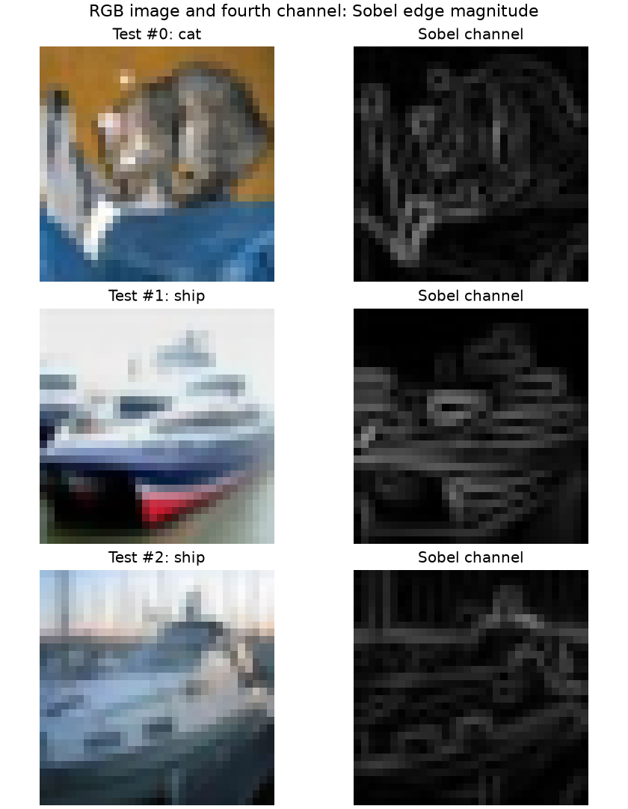
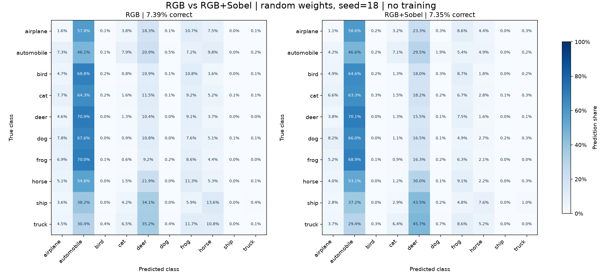

# RGB와 RGB+소벨 · 무작위 가중치 선형 분류 비교

RGB에 경계 강도를 나타내는 소벨 채널을 하나 추가했다. 픽셀당 값은 `(R, G, B, edge)` 4개이며, 32×32 이미지 한 장을 펼치면 4,096차원이다.

## 비교 조건

공식 테스트 10,000장, 시드 `18`, 편향 0, 무작위 가중치의 표준편차 `0.01`를 사용했다. 두 모델의 RGB 가중치는 정확히 공유하고 추가 경계 채널에 해당하는 가중치만 같은 난수 생성기에서 이어서 추출했다. 과제 조건에 따라 학습 없이 `Wx+b`로 예측했다.

RGB를 0~1로 변환하고 회색조 `0.299R+0.587G+0.114B`에서 소벨의 가로·세로 응답을 계산했다. `sqrt(gx²+gy²)/(4*sqrt(2))`로 경계 강도를 0~1 범위로 맞췄고, 이미지 바깥은 반사 패딩으로 처리했다.



## 결과

| 입력 | 특징 수 | 정답 이미지 수 | 정답 비율 | 평균 SVM hinge loss |
| --- | --- | --- | --- | --- |
| RGB | 3072 | 739/10,000 | 7.39% | 9.16171256 |
| RGB+Sobel | 4096 | 735/10,000 | 7.35% | 9.17453132 |

소벨 추가 후 정답 비율은 -0.04%p 바뀌었다. 이 결과는 시드 18의 무작위 가중치 한 쌍에서 얻은 관측이다. 경계 채널의 가중치도 무작위이므로 경계 정보를 정답과 연결하는 규칙을 학습한 상태가 아니다. 따라서 이 결과만으로 학습 후의 소벨 채널 효과를 결론 내릴 수 없다.

## 10×10 혼동 행렬 비교

행은 실제 클래스, 열은 예측 클래스다. 각 행은 클래스별 1,000장의 분류 비율이며 합은 100%다. 두 그림은 0~100%의 같은 파란색 눈금을 사용한다.



### RGB 분류 비율

| 실제 / 예측 | airplane | automobile | bird | cat | deer | dog | frog | horse | ship | truck |
| --- | --- | --- | --- | --- | --- | --- | --- | --- | --- | --- |
| airplane | 1.60% | 57.80% | 0.10% | 3.80% | 18.30% | 0.10% | 10.70% | 7.50% | 0.00% | 0.10% |
| automobile | 7.30% | 46.10% | 0.10% | 7.90% | 20.90% | 0.50% | 7.20% | 9.80% | 0.00% | 0.20% |
| bird | 4.70% | 68.80% | 0.20% | 0.80% | 10.90% | 0.10% | 10.80% | 3.60% | 0.00% | 0.10% |
| cat | 7.70% | 64.30% | 0.20% | 1.60% | 11.50% | 0.10% | 9.20% | 5.20% | 0.10% | 0.10% |
| deer | 4.60% | 70.90% | 0.00% | 1.30% | 10.40% | 0.00% | 9.10% | 3.70% | 0.00% | 0.00% |
| dog | 7.80% | 67.60% | 0.00% | 0.90% | 10.80% | 0.00% | 7.60% | 5.10% | 0.10% | 0.10% |
| frog | 6.90% | 70.00% | 0.10% | 0.60% | 9.20% | 0.20% | 8.60% | 4.40% | 0.00% | 0.00% |
| horse | 5.10% | 54.80% | 0.00% | 1.50% | 21.90% | 0.00% | 11.30% | 5.30% | 0.00% | 0.10% |
| ship | 3.60% | 38.20% | 0.00% | 4.20% | 34.10% | 0.00% | 5.90% | 13.60% | 0.00% | 0.40% |
| truck | 4.50% | 30.40% | 0.40% | 6.50% | 35.20% | 0.40% | 11.70% | 10.80% | 0.00% | 0.10% |

### RGB+Sobel 분류 비율

| 실제 / 예측 | airplane | automobile | bird | cat | deer | dog | frog | horse | ship | truck |
| --- | --- | --- | --- | --- | --- | --- | --- | --- | --- | --- |
| airplane | 1.10% | 58.60% | 0.20% | 3.20% | 23.30% | 0.30% | 8.60% | 4.40% | 0.00% | 0.30% |
| automobile | 4.20% | 46.60% | 0.20% | 7.10% | 29.50% | 1.90% | 5.40% | 4.90% | 0.00% | 0.20% |
| bird | 4.90% | 64.60% | 0.20% | 1.30% | 18.00% | 0.30% | 8.70% | 1.80% | 0.00% | 0.20% |
| cat | 6.60% | 63.30% | 0.30% | 1.50% | 18.20% | 0.20% | 6.70% | 2.80% | 0.10% | 0.30% |
| deer | 3.80% | 70.10% | 0.00% | 1.30% | 15.50% | 0.10% | 7.50% | 1.60% | 0.00% | 0.10% |
| dog | 8.20% | 66.00% | 0.00% | 1.10% | 16.50% | 0.10% | 4.90% | 2.70% | 0.20% | 0.30% |
| frog | 5.20% | 68.90% | 0.10% | 0.90% | 16.30% | 0.20% | 6.30% | 2.10% | 0.00% | 0.00% |
| horse | 4.00% | 53.10% | 0.00% | 1.20% | 30.00% | 0.10% | 9.10% | 2.20% | 0.00% | 0.30% |
| ship | 2.80% | 37.20% | 0.00% | 2.90% | 43.50% | 0.20% | 4.80% | 7.60% | 0.00% | 1.00% |
| truck | 3.70% | 29.40% | 0.30% | 6.40% | 45.70% | 0.70% | 8.60% | 5.20% | 0.00% | 0.00% |

## 실행

저장소 루트에서 실행한다. 데이터가 필요하면 `--download`를 추가한다.

```bash
python linear_classifier_1118/CompareRGBSobel1118.py
```

[소스 코드](../CompareRGBSobel1118.py) · [원래 수치와 설정](result.json)
