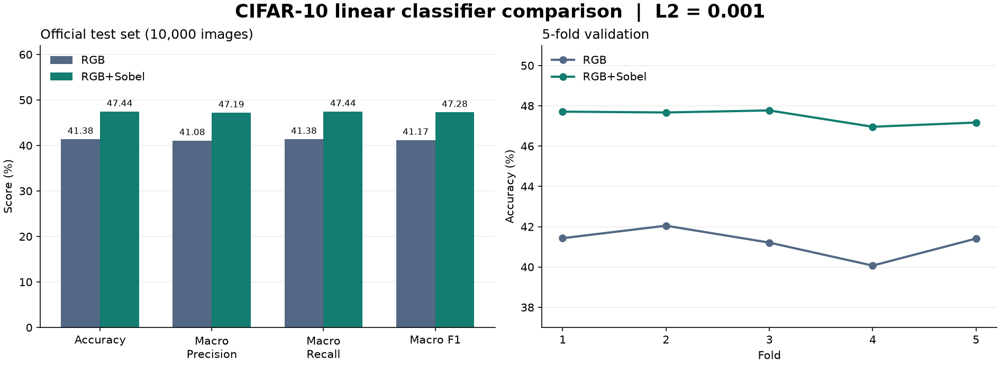
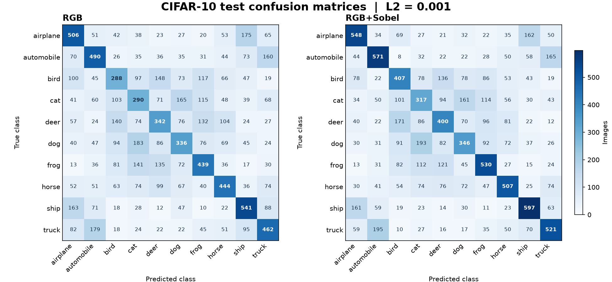

# CIFAR-10 선형 분류기 · 소벨 윤곽 채널 비교

두 모델 모두 L2 규제 강도를 `0.001`로 고정했습니다. 공식 테스트 10,000장 기준으로 정확도가 **41.38% → 47.44%**로 바뀌었습니다.

## 실험 설정

- 소프트맥스 선형 분류기, 학습률 `0.03`, 배치 128장, 40 epochs
- CIFAR-10 공식 학습 50,000장으로 같은 계층화 5-fold 분할 (`seed=42`, fold당 학습 40,000장·검증 10,000장)
- 교차 검증 후 두 모델을 각각 공식 학습 50,000장으로 다시 학습하고 동일한 공식 테스트 10,000장에 평가
- RGB는 3,072차원, RGB+소벨은 회색조의 소벨 기울기 크기 채널을 붙인 4,096차원
- 입력 평균은 각 fold의 학습 부분 또는 최종 학습 데이터에서 구함

## 성능 그래프



## 공식 테스트 성능

| 지표 | RGB | RGB+소벨 | 차이 (소벨 − RGB) |
| --- | --- | --- | --- |
| Accuracy | 41.38% | 47.44% | +6.06%p |
| Macro Precision | 41.08% | 47.19% | +6.12%p |
| Macro Recall | 41.38% | 47.44% | +6.06%p |
| Macro F1 | 41.17% | 47.28% | +6.11%p |

## 5-fold 정확도

| 지표 | RGB | RGB+소벨 | 차이 (소벨 − RGB) |
| --- | --- | --- | --- |
| Fold 1 | 41.43% | 47.71% | +6.28%p |
| Fold 2 | 42.05% | 47.67% | +5.62%p |
| Fold 3 | 41.21% | 47.77% | +6.56%p |
| Fold 4 | 40.07% | 46.96% | +6.89%p |
| Fold 5 | 41.41% | 47.17% | +5.76%p |
| 평균 | 41.23% | 47.46% | +6.22%p |

## 클래스별 성능

| 클래스 | 테스트 장수 | RGB Precision | RGB Recall | RGB F1 | 소벨 Precision | 소벨 Recall | 소벨 F1 |
| --- | --- | --- | --- | --- | --- | --- | --- |
| airplane | 1000 | 45.02% | 50.60% | 47.65% | 52.84% | 54.80% | 53.80% |
| automobile | 1000 | 46.49% | 49.00% | 47.71% | 54.07% | 57.10% | 55.54% |
| bird | 1000 | 32.99% | 28.80% | 30.75% | 40.22% | 40.70% | 40.46% |
| cat | 1000 | 29.47% | 29.00% | 29.23% | 32.71% | 31.70% | 32.20% |
| deer | 1000 | 35.11% | 34.20% | 34.65% | 40.73% | 40.00% | 40.36% |
| dog | 1000 | 36.52% | 33.60% | 35.00% | 39.63% | 34.60% | 36.95% |
| frog | 1000 | 42.83% | 43.90% | 43.36% | 49.95% | 53.00% | 51.43% |
| horse | 1000 | 47.39% | 44.40% | 45.84% | 53.14% | 50.70% | 51.89% |
| ship | 1000 | 49.54% | 54.10% | 51.72% | 56.37% | 59.70% | 57.99% |
| truck | 1000 | 45.43% | 46.20% | 45.81% | 52.26% | 52.10% | 52.18% |

## 정답과 예측의 매칭 · 혼동 행렬

행은 실제 정답, 열은 모델의 예측입니다. 대각선은 올바르게 분류된 이미지 수입니다. 두 그림의 색상 눈금은 같습니다.



<details>
<summary>RGB 혼동 행렬 표 (이미지 수)</summary>

| 정답 / 예측 | airplane | automobile | bird | cat | deer | dog | frog | horse | ship | truck |
| --- | --- | --- | --- | --- | --- | --- | --- | --- | --- | --- |
| airplane | 506 | 51 | 42 | 38 | 23 | 27 | 20 | 53 | 175 | 65 |
| automobile | 70 | 490 | 26 | 35 | 36 | 35 | 31 | 44 | 73 | 160 |
| bird | 100 | 45 | 288 | 97 | 148 | 73 | 117 | 66 | 47 | 19 |
| cat | 41 | 60 | 103 | 290 | 71 | 165 | 115 | 48 | 39 | 68 |
| deer | 57 | 24 | 140 | 74 | 342 | 76 | 132 | 104 | 24 | 27 |
| dog | 40 | 47 | 94 | 183 | 86 | 336 | 76 | 69 | 45 | 24 |
| frog | 13 | 36 | 81 | 141 | 135 | 72 | 439 | 36 | 17 | 30 |
| horse | 52 | 51 | 63 | 74 | 99 | 67 | 40 | 444 | 36 | 74 |
| ship | 163 | 71 | 18 | 28 | 12 | 47 | 10 | 22 | 541 | 88 |
| truck | 82 | 179 | 18 | 24 | 22 | 22 | 45 | 51 | 95 | 462 |

</details>

<details>
<summary>RGB+Sobel 혼동 행렬 표 (이미지 수)</summary>

| 정답 / 예측 | airplane | automobile | bird | cat | deer | dog | frog | horse | ship | truck |
| --- | --- | --- | --- | --- | --- | --- | --- | --- | --- | --- |
| airplane | 548 | 34 | 69 | 27 | 21 | 32 | 22 | 35 | 162 | 50 |
| automobile | 44 | 571 | 8 | 32 | 22 | 22 | 28 | 50 | 58 | 165 |
| bird | 78 | 22 | 407 | 78 | 136 | 78 | 86 | 53 | 43 | 19 |
| cat | 34 | 50 | 101 | 317 | 94 | 161 | 114 | 56 | 30 | 43 |
| deer | 40 | 22 | 171 | 86 | 400 | 70 | 96 | 81 | 22 | 12 |
| dog | 30 | 31 | 91 | 193 | 82 | 346 | 92 | 72 | 37 | 26 |
| frog | 13 | 31 | 82 | 112 | 121 | 45 | 530 | 27 | 15 | 24 |
| horse | 30 | 41 | 54 | 74 | 76 | 72 | 47 | 507 | 25 | 74 |
| ship | 161 | 59 | 19 | 23 | 14 | 30 | 11 | 23 | 597 | 63 |
| truck | 59 | 195 | 10 | 27 | 16 | 17 | 35 | 50 | 70 | 521 |

</details>

## 같은 이미지의 정답 여부 비교

| RGB 정답 여부 | 소벨 오답 | 소벨 정답 |
| --- | --- | --- |
| RGB 오답 | 4,621 | 1,241 |
| RGB 정답 | 635 | 3,503 |

소벨 채널 추가 후 기존 오답 1,241장이 정답으로 바뀌었고, 기존 정답 635장이 오답으로 바뀌었습니다.

## 재현 방법

저장소 루트에서 아래 명령을 실행합니다. `--download`는 `data/`에 CIFAR-10이 필요할 때 사용합니다.

```bash
pip install -r requirements.txt
python sobel_comparison/compare.py --download
python sobel_comparison/render_report.py
```

[원본 측정값](metrics.json)에는 fold별 지표와 혼동 행렬의 이미지 수를 기록했습니다.
